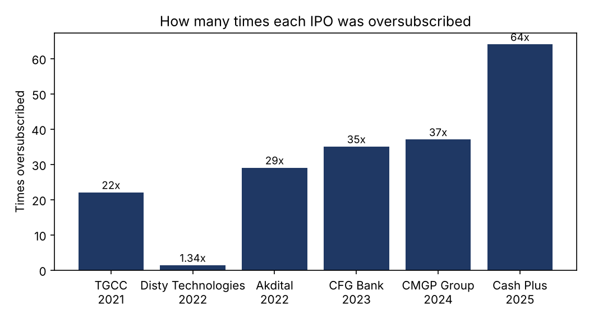
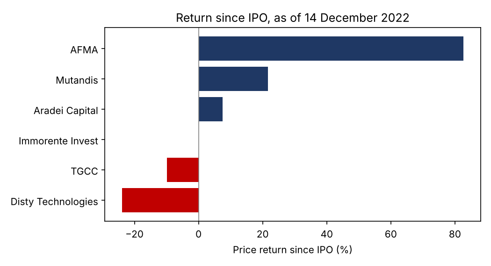
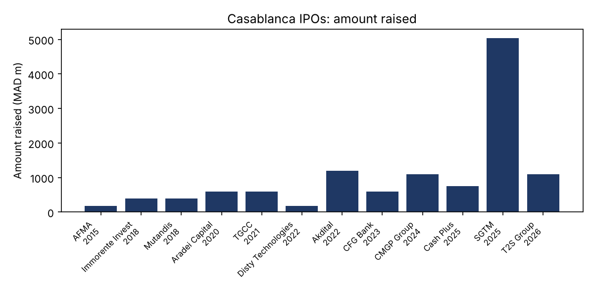

# How Did Moroccan IPOs Perform?

**Status:** version 0.1, working. Next version planned for December 2026.

How have companies that listed on the Casablanca Stock Exchange performed since their IPO, how strong is investor demand, and does sector or size make a difference?

## What is already done
- **A sourced dataset of 12 IPOs from 2015 to 2026** ([`data/ipos.csv`](data/ipos.csv)): IPO date and price, amount raised, and investor demand, each with its source in [`data/SOURCES.md`](data/SOURCES.md).
- **Automatic return calculation** ([`src/returns.py`](src/returns.py)): return since IPO and return per year, for every price snapshot added to [`data/prices.csv`](data/prices.csv).
- **Charts and a results table** in [`output/`](output/), regenerated with one command.

## First findings

**1. Demand for IPOs has grown strongly.** Main-market IPOs went from 22 times oversubscribed for TGCC (2021) to 37 times for CMGP Group (2024) and 64 times for Cash Plus (2025). Disty Technologies (1.34 times) is the exception: it listed on the alternative market for smaller companies.



**2. High demand does not guarantee a gain.** On 14 December 2022, TGCC traded 9.9% below its IPO price and Disty Technologies 23.9% below, while AFMA was 82.6% above its 2015 IPO price.



**3. Mutandis, long term:** listed at 180 MAD in December 2018 and trading at 228.50 MAD on 20 November 2026, a price return of **+26.9%, or about +3.1% per year**, before dividends. Mutandis pays a regular dividend (10.5 MAD per share for 2024 and 2025), so the total return to shareholders is higher. See [mutandis-valuation](https://github.com/KamarIsTheMoon/mutandis-valuation).

**4. IPO sizes are getting much larger.** Most IPOs raised between 170 and 1,200 MAD m, until SGTM in December 2025 offered up to 5,040 MAD m.



> These are price returns only, at the dates shown. Most recent IPOs do not have a current price in the dataset yet, so no conclusion is drawn about them.

## Run it
```
pip install -r requirements.txt
python -m src.run          # writes output/results.md, returns.csv and charts
python -m pytest tests     # automated tests
```
To add a price: one row in `data/prices.csv` (ticker, date, price, source). Returns update automatically.

## Repository
```
data/     IPO dataset, price snapshots, sources
src/      return calculations and runner
output/   results table and charts
tests/    automated tests
```

## Roadmap
- [x] Sourced dataset of 12 IPOs since 2015
- [x] Return since IPO and per year, for any price snapshot
- [x] Demand and size charts
- [ ] Current price of every company, all on the same date
- [ ] First-day return of each IPO (underpricing)
- [ ] Comparison with the MASI index over the same periods
- [ ] Total return including dividends
- [ ] Check each IPO against its prospectus on ammc.ma
- [ ] Power BI dashboard

*Student project for learning purposes. Not investment advice.*

© 2026 Kamar Maroihi. All rights reserved.
